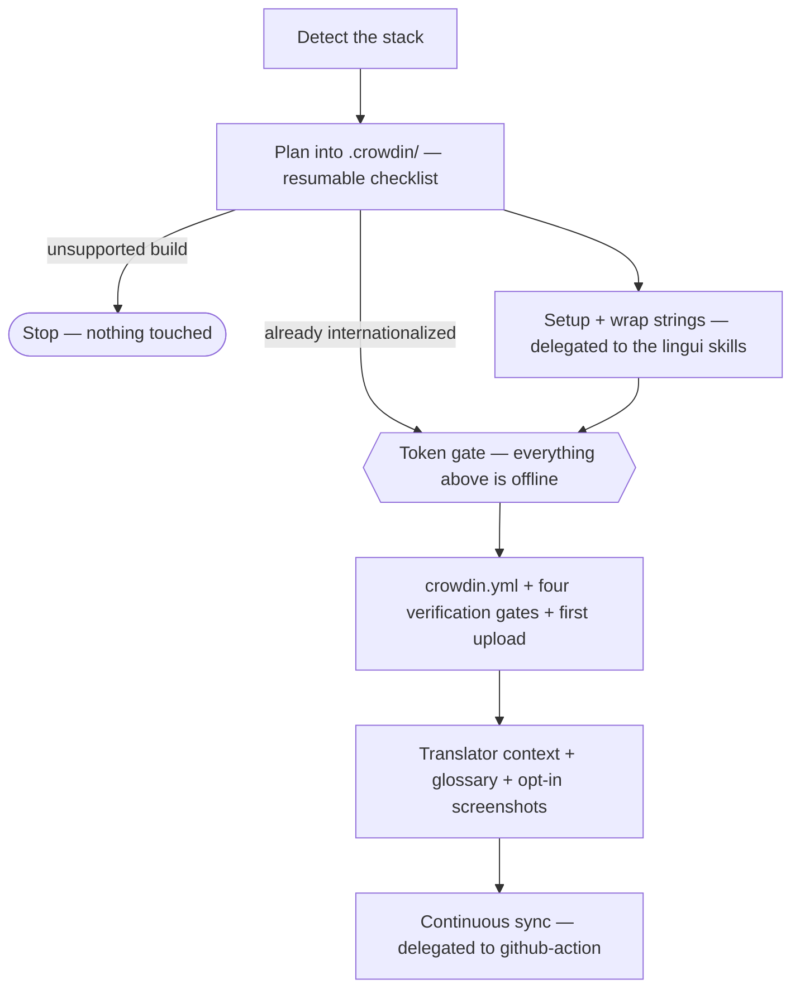

# Crowdin Skills

[](https://skills.sh/crowdin/skills)

This repository contains Agent Skills for [Crowdin](https://crowdin.com), an AI-powered localization platform for teams and businesses.

## What are Agent Skills?

Skills are reusable capabilities for AI coding agents. They provide procedural knowledge and best practices that help AI agents implement features correctly and efficiently.

## Installation

Install all Crowdin skills with a single command:

```bash
npx skills add crowdin/skills
```

This gives your AI coding agent access to comprehensive Crowdin knowledge including best practices, common pitfalls, and configuration patterns.

### Claude Code Plugin

Alternatively, install the skills as a [Claude Code plugin](https://code.claude.com/docs/en/discover-plugins). In Claude Code, run:

```
/plugin marketplace add crowdin/skills
/plugin install crowdin@crowdin-skills
```

All skills load automatically. Every commit to `main` is a new plugin version, so newly added skills reach you as soon as the plugin updates. Turn on auto-update once (run `/plugin`, open the **Marketplaces** tab, select `crowdin-skills`, choose **Enable auto-update**), or update by hand:

```
/plugin update crowdin@crowdin-skills
/reload-plugins
```

A running session keeps the version it started with, so new skills appear after `/reload-plugins` or a restart. Note that `/plugin marketplace update` only refreshes the catalog and does not update the installed plugin.

The plugin also includes the [Crowdin MCP Server](https://support.crowdin.com/developer/crowdin-mcp-server/), giving your agent direct access to Crowdin projects. Authenticate via the browser OAuth flow on first use (`/mcp` in Claude Code). Crowdin Enterprise users should connect their organization endpoint (`https://{organization}.mcp.crowdin.com/v2/mcp`) manually instead.

### Claude Cowork

[Cowork](https://claude.com/docs/cowork/guide/plugins) installs the same plugin. Open **Customize** in the sidebar, go to **Plugins**, select **Add marketplace**, and enter `crowdin/skills` (the full `https://github.com/crowdin/skills` URL works too). The `crowdin` plugin then appears among the other marketplaces — install it there, and press **Update** on the marketplace later to pull newer versions.

The bundled Crowdin MCP server shows up as a connector and asks you to sign in on first use. Plugins require a paid plan and run in Cowork and Claude Code, not in Chat — to use one skill on its own, zip its folder from `skills/` and upload it under **Customize → Skills**.

### OpenAI Codex

The repo is also a Codex plugin marketplace. In Codex CLI (0.142 or newer):

```bash
codex plugin marketplace add crowdin/skills
codex plugin add crowdin@crowdin-skills
```

Start a new session afterwards so the bundled skills load. The plugin includes the same Crowdin MCP Server as the Claude Code plugin. A skills-only build of it (`scripts/openai/build-archive.sh`, run on every version tag such as `1.2.0`) is what gets submitted to the OpenAI plugin directory for ChatGPT and Codex.


### Other Agent Tools (Plugin Install)

The repo is also installable as a plugin via the [`plugins` CLI](https://npmx.dev/package/plugins), which auto-detects your installed agent tools (Claude Code, Cursor, Codex, Grok Build, Kimi Code, GitHub Copilot CLI, VS Code) and installs through each tool's native plugin system:

```bash
npx plugins add crowdin/skills
```

### Gemini CLI

The repo is a [Gemini CLI extension](https://geminicli.com/docs/extensions/) — install it with:

```bash
gemini extensions install https://github.com/crowdin/skills
```

### GitHub CLI

The [GitHub CLI](https://cli.github.com) (v2.90+) can install the skills for GitHub Copilot or any other supported agent:

```bash
gh skill install crowdin/skills --all
```

Use `--agent <name>` (e.g. `--agent cursor`) to target a specific tool, and `gh skill update` to pull newer versions.

## Available Skills

### create-app

Builds a Crowdin app end to end and leaves the user looking at it: scaffolds with `@crowdin/serverless-apps-cli`, writes the UI with `@crowdin/serverless-apps-sdk`, publishes into the organization and opens it. Written for translators and localization managers rather than developers, so it derives what it can (edition, placement, scopes, editor modes) and asks only questions a non-programmer can answer. Covers the placements that have no preview link, the requests that need a backend and what to offer instead, and the checks that catch a published app which does not actually render.

### crowdin-cli

Guides correct usage of the Crowdin CLI — the `crowdin` command that syncs localization files between a local project and Crowdin. Covers installation and authentication, `crowdin.yml` configuration (placeholders, file groups, language mapping), the core upload/download workflow, `auto-translate`, the `crowdin context` commands for AI context enrichment, integrations driven through installed Crowdin apps, machine-readable output for scripts and agents (`-o json|toon|plain`), exit codes, CI/CD patterns, and migration from CLI v4.

### github-action

Sets up, reviews, and debugs [crowdin/github-action](https://github.com/crowdin/github-action) — the workflow step that syncs sources and translations and opens the translation PR. Covers the fixed pipeline a single step runs (and the defaults that surprise people), the git half it performs after a download, secrets, token scopes and the permissions PR creation needs, the `command` escape hatch and what it silently skips, and a symptom → cause table for runs that produce no PR or no CI checks. Ships a full inputs/outputs reference and recipes for the patterns upstream doesn't document — split upload/download workflows, GitHub App auth, post-processing before the PR — linking to the action's own examples for the rest.

### integration-sync

Runs an installed Crowdin integration app's sync loop: imports content from the connected platform (Webflow, HubSpot, Contentful, Zendesk Guide, Braze and the other store integrations) into Crowdin, follows the job, pushes translations back, and reads or changes the auto-sync schedule. Runs through the Crowdin connector in Cowork, Claude.ai, ChatGPT or Crowdin Copilot, and through `crowdin app api` in a terminal, with the same rules on both: IDs are copied from the app's own output, every state-changing call is shown before it is sent, and a job is reported finished only once that status was seen.

### context-extraction

Fills `ai_context` in Crowdin JSONL files so translators get clear context. Covers which strings need context (ambiguous short words, plurals, inline tags, etc.), how to write 1–3 sentence descriptions (UI element type, placement), and safe editing rules (only edit `ai_context`, validity checklist). Runs the loop around them: `crowdin context download` → fill `ai_context` → `crowdin context upload`.

### glossary-terms-extraction

Builds or tops up a Crowdin glossary from real content — the project's source strings plus any docs, websites or files the user supplies — and adds terms only after the user reviews them. Covers which terms earn an entry (product and feature names, domain vocabulary, words that are ambiguous out of context, objects that must stay distinct), dictionary forms and descriptions translators can act on, and translations lifted only from the user's own translated material, never invented. Runs two ways: through the Crowdin connector's tools in reviewed rounds of about ten, with each definition on the concept and brand names marked non-translatable; or from a terminal, as a reviewed CSV draft and an idempotent `crowdin glossary upload` — `glossary list` first, merge into an existing glossary with `--id`, never a duplicate. `i18n-setup` delegates its glossary steps here.

### glossary-term-translations

Fills in the translations of glossary terms from how the project already translated them, through the Crowdin connector. For each term it finds the strings that contain it, reads their final translations, picks the counterpart in each language and writes it as a Draft term under the term's concept, with a review link per concept. Nothing is invented: a language with no clear counterpart stays empty, different renderings of the same term are put to the user to pick, and every round is shown as a table and confirmed before anything is written. Also backfills the languages existing concepts lack. A user who cannot see the project's glossary, usually a translator, is shown what the translations say and told who can write them. Complements `glossary-terms-extraction`, which finds the terms worth adding.

### translate

Drafts translations into the project's own resource files — whatever format `crowdin.yml` uploads — from the terminal, and uploads them to Crowdin as unapproved suggestions for review. Syncs first so nobody's finished work is drafted over, reads the project's assigned glossary, TM and style guide through the CLI, follows source references into the code when a string is ambiguous, and checks every draft's placeholders and plural categories with a format-neutral ledger before anything goes up. Never approves, never writes the source catalog, never invents a glossary term. Warns rather than refuses on large runs and names Crowdin's own pre-translation as the bulk route. `i18n-setup` delegates here when the user asks for translations during the journey.

### generate-screenshots

Gives translators the screen a string lives on. The skill finds which strings in a Crowdin project have no screenshot yet, plans the screens worth capturing and lets the user review that plan, then captures the running app and uploads the images to Crowdin, where auto-tagging links every visible string to its place on the image. Works for web, mobile and desktop apps, using the project's own UI tooling to capture (Playwright, Maestro, XCUITest, or an existing screenmap setup) and leaving that capture in the repository, so the next release is a quick top-up rather than a fresh walk through the app. Re-runs update existing screenshots in place, nothing is deleted or invented on the user's behalf, and the report says which strings still lack a screenshot and why.

### crowdin-api-client

Guides practical usage of `@crowdin/crowdin-api-client` for production workflows. Covers client/module selection, pagination, uploads via storage + file creation, translation build/download flow, runtime options (`fetch`, retries, timeout), and error handling patterns. Ships a recipes reference with type-checked multi-step flows — waiting on long-running operations, uploading or updating files, building and downloading translations, pre-translation, CroQL filter to label to task, batch string edits, TM and glossary import and export, QA issue triage, screenshots, over-the-air releases, reports.

### croql

Helps build, validate, and optimize Crowdin CroQL expressions for strings, translations, TM segments, and glossary terms. Includes operator guidance, context-specific fields, editor-filter equivalents, and API endpoint templates with URL-encoding reminders.

### graphql

Helps write and debug valid Crowdin GraphQL queries with schema-aware arguments, pagination, filtering/sorting, and node/rate-limit safety checks. Includes a troubleshooting pattern for common Playground errors like unsupported field arguments.

### how-to-crowdin

Answers "how do I do X in Crowdin" by mapping a localization pain to the cheapest thing Crowdin already offers: a built-in feature the user never found, a few actions through the Crowdin connector or API, an app from the [Crowdin Store](https://store.crowdin.com), or a custom app. A map of around ninety problem families — mined from every store listing and the product documentation — gives the rung and the hand-off, and the exact how goes to the skill that owns it (`croql`, `graphql`, `crowdin-api-client`, `crowdin-cli`, `create-app`). Written for a localization manager working through an assistant with the Crowdin connector, so answers are phrased as actions on Crowdin objects, bulk changes are counted and confirmed first, and an app is named only after the live store catalog confirms it. It also explains how the built-in reports, from Cost estimate and Translation cost to Top members, are calculated and why a report shows a given number.

### i18n-setup

Takes a project from hardcoded strings to continuously translating through Crowdin — or connects an already-internationalized project. Detects the stack, delegates library implementation to the ecosystem's own skills (v1: JavaScript/TypeScript + Lingui via the `lingui` plugin, whichever framework the project uses), wraps existing strings with a self-healing recall check, writes a verified `crowdin.yml`, enriches string context for translators, drafts a reviewed starting glossary, captures and uploads screenshots when the user opts in, and hands continuous sync to the `github-action` skill. Plans into a resumable `.crowdin/` workspace; runs on any agent, uses parallel subagents when available.

See the skill in action: [i18n-setup demo on YouTube](https://www.youtube.com/watch?v=Hc6StVCp7U0).



The Lingui stack requires the `lingui` plugin — the setup, wrapping, and recall passes are delegated to it rather than duplicated here. A run installs it when missing and stops to ask only when that install can't run — never improvising library guidance in its place. The glossary, screenshot, and CI phases delegate the same way to the `glossary-terms-extraction`, `generate-screenshots`, and `github-action` skills below, which ship in this repository — installing the whole set, or the plugin, already covers them.

### feedback

Records feedback about Crowdin for the Crowdin team: a skill in this plugin that gave wrong instructions, a Crowdin CLI or API limitation, an MCP server tool that failed, a capability Crowdin lacks. The agent drafts a short, factual report on your machine at high-signal moments or when you ask, and sends it as a public GitHub issue in this repository only when you explicitly say so. See [Feedback](#feedback-1) below for what is included and what never is.

## Quick Start

1. **Install all Crowdin skills:**
   ```bash
   npx skills add crowdin/skills
   ```

2. **Use with your AI coding agent:**
   The skills will automatically be available when working on projects that use Crowdin, or when you mention terms that fall under the scope of the skills.

3. **Manual trigger:**
   You can explicitly reference the skills in your prompts:
   ```
   "Using the Crowdin skills, help me enrich the context of strings before translation starts"
   ```

### Installing Individual Skills

If you prefer, you can install specific skills:
```bash
npx skills add crowdin/skills --skill create-app
npx skills add crowdin/skills --skill crowdin-cli
npx skills add crowdin/skills --skill github-action
npx skills add crowdin/skills --skill integration-sync
npx skills add crowdin/skills --skill context-extraction
npx skills add crowdin/skills --skill glossary-terms-extraction
npx skills add crowdin/skills --skill glossary-term-translations
npx skills add crowdin/skills --skill translate
npx skills add crowdin/skills --skill generate-screenshots
npx skills add crowdin/skills --skill crowdin-api-client
npx skills add crowdin/skills --skill croql
npx skills add crowdin/skills --skill graphql
npx skills add crowdin/skills --skill how-to-crowdin
npx skills add crowdin/skills --skill i18n-setup
npx skills add crowdin/skills --skill feedback
```

## Feedback

When something about Crowdin gets in the way while an agent works with these skills, the `feedback` skill turns it into a report for the Crowdin team without leaving the session.

**How it works.** The agent drafts a report when you ask ("report this", "file feedback", "tell Crowdin about this") or on its own after a Crowdin skill instruction, CLI command, MCP tool call or API call failed reproducibly, when you are clearly frustrated with a Crowdin component, or when a Crowdin capability you expected does not exist. The draft is a Markdown file in `~/.crowdin/feedback/` on your machine, outside any repository, with a fixed structure: type (`bug`, `idea` or `missing_capability`), component, what happened, what you said, how to reproduce it, evidence. Everything in it comes from the session; unknown fields stay blank. Drafting never interrupts your task: at most one line at the end of a reply tells you a draft exists.

**Where it goes.** Nothing leaves your machine until you say "send feedback" after seeing the draft. Then the agent opens a public issue in this repository with GitHub's `gh` CLI when it is installed and authenticated, or gives you a prefilled new-issue link to submit yourself. For anything you do not want public, hand the draft to [Crowdin support](https://crowdin.com/contacts) instead.

**What is never included.** Tokens or credentials, Crowdin organization or project names and identifiers, source strings, translations, glossary terms or file contents from your project, and people's names (roles are used instead). These rules apply when the draft is written, so the file on disk is already safe to share.

## Compatibility

These skills are compatible with:
- [Claude Code](https://claude.ai/product/claude-code)
- [Cursor](https://cursor.sh)
- [OpenAI Codex](https://openai.com/codex/)
- [Gemini CLI](https://geminicli.com)
- [GitHub Copilot](https://github.com/features/copilot)
- [OpenCode](https://opencode.ai)
- [Cline](https://cline.bot/)
- [Windsurf](https://codeium.com/windsurf)
- And other agents supporting the [Agent Skills](https://agentskills.io) format

## Resources

- [Crowdin Documentation](https://support.crowdin.com)
- [Crowdin GitHub](https://github.com/crowdin)
- [Skills.sh](https://skills.sh)
